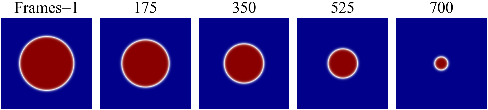
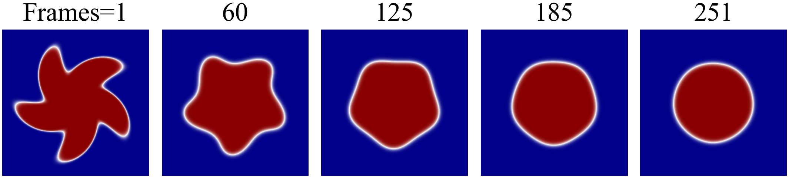
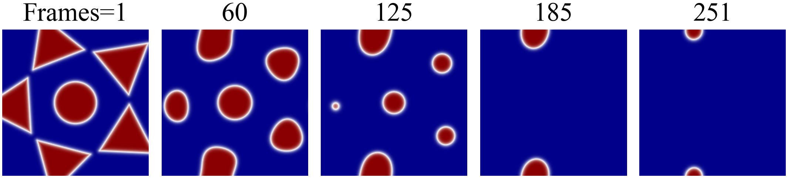
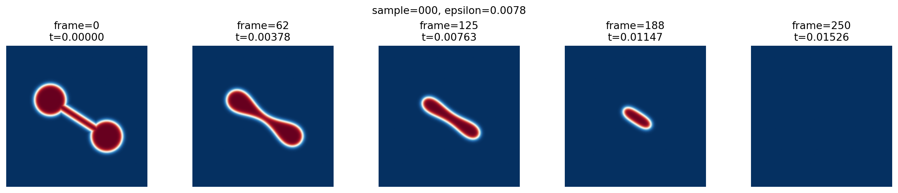

# IADR — Source Code
IADR: Interface-Augmented Neural Operator for Phase-Field Mean-Curvature Flow, 40th Conference on Neural Information Processing Systems (NeurIPS 2026).

## 1. Introduction

The Allen–Cahn equation is one of the standard phase-field models for mean-curvature flow (MCF), parameterised by the diffuse-interface width $\varepsilon$. Practical simulations span a working range of $\varepsilon$, so a single model covering this range is needed. PDE-specific neural operators are accurate but must be retrained at every $\varepsilon$; general neural operators cover $\varepsilon$ in one model but lose the phase-field structure of the target. We introduce Interface-Augmented Diffusion-Reaction (IADR), a neural operator that addresses both shortcomings: a target network with a diffusion-and-reaction structure preserves the phase-field structure of the Allen–Cahn equation, while a hypernetwork that maps $\varepsilon$ to the weights of this target network amortises the dependence on $\varepsilon$ across the working range. A single IADR matches the per-$\varepsilon$ specialists on in-distribution data within the prescribed working range, retains their cross-shape generalisation under both $\varepsilon$- and geometry-out-of-distribution shifts, and retains their compact DR target structure with millisecond-scale inference. We further establish a conditional $K$-step rollout error bound under consistency and stability assumptions.

---

## 2. Model and datasets

### 2.1 IADR

IADR combines a diffusion–reaction (DR) target network with a hypernetwork
conditioned on the interface width $\varepsilon$. The target network applies
a spatial diffusion convolution followed by a pointwise reaction MLP. The
hypernetwork maps $\varepsilon$ to the complete weights of both blocks, so
one model represents the operator family across a prescribed working range.
The same one-step operator is applied autoregressively to predict a trajectory.

The model is implemented in [`code/models_IADR.py`](code/models_IADR.py),
with its training configuration in [`code/config/IADR.yml`](code/config/IADR.yml).
The paper trains on circles and evaluates generalisation to unseen interface
widths and geometries. The four dataset geometries are introduced below.

All four generators use the periodic domain $[0,1]^2$ with a default
$256\times256$ grid. The parameter ranges below describe the **bundled
shell launchers**. Each panel shows five frames from one existing dataset
sample at $\varepsilon=0.0078$; generation commands are in Section 5.2.

### 2.2 Circle

Circular initial regions vary in size and position:

- Radius: uniformly sampled from $[0.25,0.35]$.
- Centre: each coordinate is uniformly sampled from $[0.47,0.53]$.
- The launcher saves 700 frames per trajectory.



*Circle, sample 000: frames 1, 175, 350, 525, and 700.*

### 2.3 Spiral disk (SD)

A spiral disk is formed by displacing a disk with the spatial ripple
$a\sin(k_r r+k_\theta\theta)$, followed by rotation and translation:

- Base radius: $[0.28,0.32]$; ripple amplitude $a$: $[0.08,0.10]$.
- Radial frequency $k_r$: sampled from $\{10,11,12\}$; angular frequency
  $k_\theta=5$.
- Centre: $(0.5,0.5)$; orientation: uniformly sampled from $[0,2\pi)$.
- The launcher saves 251 frames per trajectory.



*Spiral disk, sample 000: frames 1, 60, 125, 185, and 251.*

### 2.4 Five-pointed star (FS)

The star configuration is the union of a central disk and five equally
spaced triangular arms. The arms share the sampled size and radial offset:

- Number of arms: 5; each arm is an equilateral triangle with circumradius
  sampled from $[0.20,0.22]$.
- Arm offset before rotation: $x\in[0.38,0.43]$, $y=0$.
- Central disk radius: $[0.14,0.15]$.
- Centre: $(0.5,0.5)$; overall orientation: uniformly sampled from $[0,2\pi)$.
- The launcher saves 251 frames per trajectory.



*Five-pointed star, sample 000: frames 1, 60, 125, 185, and 251.*

### 2.5 Dumbbell decomposition

A dumbbell is the union of two equal disks and a capsule joining their
centres. The launcher varies the lobe size, separation, neck width,
position, and orientation:

- Disk radius: $0.12$ with total jitter width $0.02$, giving $[0.11,0.13]$.
- Half the centre-to-centre distance: $0.25$ with total jitter width $0.04$,
  giving $[0.23,0.27]$.
- Neck-width parameter: $0.06$ with total jitter width $0.02$,
  giving $[0.05,0.07]$.
- Midpoint: $(0.5,0.5)$ with total jitter width $0.04$ in each coordinate,
  giving $[0.48,0.52]$ per coordinate.
- Orientation: uniformly sampled from $[0,\pi)$; minimum boundary margin: $0.05$.
- The launcher saves 251 frames per trajectory.

A jitter width $j$ means a uniform perturbation in $[-j/2,j/2]$.



*Dumbbell, sample 000: frames 0, 62, 125, 188, and 250, using the generator's
zero-based frame labels.*

---

## 3. Repository layout

```
material/
├── README.md                       (this file)
├── assets/datasets/                # one sample panel per dataset
├── code/
│   ├── config/                     # 9 YAML configs, one per baseline (+ template + Blind DR)
│   │   ├── IADR.yml                  # IADR
│   │   ├── IADR_DiffOnly.yml         # Hyper-D ablation
│   │   ├── IADR_ReactOnly.yml        # Hyper-R ablation
│   │   ├── IADR_UNET.yml             # U-Net variant
│   │   ├── DR1_blind_5eps.yml             # Blind DR ablation
│   │   ├── DR1_per_eps_template.yml       # template for the 8 per-eps specialists
│   │   ├── FNO_concat.yml                 # FNO baseline
│   │   ├── DR1_temp.yml                   # bare DR1 schedule template
│   │   └── FullDisco_A.yml                # DISCO baseline
│   │
│   ├── models_IADR.py              # IADR (IADR class) and the higher-order IADR2
│   ├── models_per_epsilon.py       # per-eps DR / Blind DR (DR1, DR2 standalone classes)
│   ├── models_disco_unet.py        # U-Net variant target (UNet_DISCO)
│   ├── models_FNO.py               # FNO baseline (FNO_Epsilon, FNO_Epsilon_FiLM)
│   ├── models_full_disco_A.py      # DISCO baseline core
│   ├── models_full_disco_A_runnable.py  # PL wrapper of DISCO with our dataloader
│   ├── models_ours_ablation.py     # Hyper-D, Hyper-R ablation classes
│   │
│   ├── get_datasets_circle_random.{py,sh}  # circle dataset generation
│   ├── get_datasets_fs.{py,sh}             # five-pointed-star dataset generation
│   ├── get_datasets_sd.{py,sh}             # spiral-disk dataset generation
│   ├── get_datasets_dumbbell.py            # dumbbell decomposition dataset generation
│   ├── generate_dumbbell_datasets.sh       # dumbbell batch launcher
│   │
│   ├── test_dr1_bootstrap.py       # rollout evaluation + bootstrap per-metric statistics
│   ├── log_to_xlsx_bootstrap.py    # parse rollout logs → consolidated xlsx
│   ├── run_dr1_bootstrap_serial.sh # batch evaluation driver across (model, shape, eps)
│   └── train0.sh                   # per-eps training sweep template
│
└── datasets_light/
    └── train_std_small/            # 80 MB sliced subset of the standard training set
        ├── train_dataset_5.npy           # (5, 2, 8, 1, 256, 256), float64
        ├── train_dataset_eps_5.npy       # (5,), the five training eps values
        ├── valid_dataset_5.npy           # (5, 6, 8, 1, 256, 256), float64
        └── valid_dataset_eps_5.npy       # (5,)
```

The `datasets_light/` subset is sliced from the full ~1.8 GB standard training
set so that the package fits a typical supplementary-material size budget.
It is large enough for every model class to *load and train for a few epochs*
on representative data; reproducing the paper's reported metrics requires
regenerating the full dataset (see Section 6).

---

## 4. Installation

The minimum environment for IADR, the per-eps DR specialists, the U-Net
variant, the FNO baseline, and the Hyper-D / Hyper-R / Blind DR ablations is

```bash
pip install nnpf
```

`nnpf` brings in the rest of the standard scientific stack (PyTorch, NumPy,
PyTorch Lightning, PyYAML, matplotlib, Pillow, tqdm). For the evaluation
post-processing pipeline (`log_to_xlsx_bootstrap.py`) you additionally need

```bash
pip install openpyxl
```

The DISCO baseline (`models_full_disco_A*.py` + `config/FullDisco_A.yml`) needs
the upstream DISCO repository checked out separately, plus two extra
dependencies:

```bash
pip install timm einops
git clone <DISCO repository URL>     # path elided for anonymous review
export DISCO_ROOT=/absolute/path/to/disco_repo
export PYTHONPATH="${DISCO_ROOT}:${PYTHONPATH}"
```

Without `DISCO_ROOT` set, the DISCO baseline will refuse to start; all other models run under the minimum environment alone.

A Python version of 3.9 or newer is recommended; we tested under CUDA on a single NVIDIA V100 GPU.

---

## 5. Data

### 5.1 What is in `datasets_light/`

`datasets_light/train_std_small/` contains the sliced *standard-variant*
training data used by every model in the paper except the DISCO baseline:

| File                              | Shape                          | Dtype    |
|-----------------------------------|--------------------------------|----------|
| `train_dataset_5.npy`             | `(5, 2, 8, 1, 256, 256)`       | float64  |
| `train_dataset_eps_5.npy`         | `(5,)`                         | float64  |
| `valid_dataset_5.npy`             | `(5, 6, 8, 1, 256, 256)`       | float64  |
| `valid_dataset_eps_5.npy`         | `(5,)`                         | float64  |

Axes are `(N_eps, T, N_per_eps, channel=1, H, W)`. The eight retained samples
per eps are simply the first eight along the original `N_per_eps` axis of the
full set.

The DISCO variant (16-frame context) requires a different layout
(`(N_eps, T+1 or T+6, N_per_eps, 1, H, W)` with `T = n_past = 16`). It is *not*
included in this lightweight subset; regenerate it with
`get_datasets_circle_random.py` (see Section 5.2). Likewise, the per-eps
single-eps datasets used by the per-eps DR specialists in
`config/DR1_per_eps_template.yml` are not in the subset.

### 5.2 Generating circle, SD, FS, and dumbbell datasets

The four generators and their launchers are in `code/`. These launchers
produce rollout/test datasets; they do not create the standard or DISCO
training/validation splits. Run the following commands from `material/`
on the data-generation machine:

```bash
cd code

# Circles
bash get_datasets_circle_random.sh

# Spiral disk (SD)
bash get_datasets_sd.sh

# Five-pointed star (FS)
bash get_datasets_fs.sh

# Dumbbell decomposition
DEVICE=cuda bash generate_dumbbell_datasets.sh
```

The downloaded launchers currently use these settings:

| Geometry  | Samples per epsilon | Saved frames | Output directory, relative to `code/` |
|----------|---------------------|--------------|--------------------------------------|
| Circle | 100 | 700 | `bootstrap_test_datasets_wide/circle/` |
| SD | 100 | 251 | `bootstrap_test_datasets_wide/spiral_disk/` |
| FS | 100 | 251 | `bootstrap_test_datasets_wide/five_stars/` |
| Dumbbell| 100 | 251 | `bootstrap_test_datasets_n40/dumbbell/` |

All four launchers use a `256 x 256` grid. The saved frame count is
`STEPS + 1`, including the initial state. Change the epsilon list, `GRID`,
`STEPS`, and `N_PER_EPS` (or `NUM_SAMPLES` for dumbbell) in the relevant
launcher to generate a different configuration.

Each generator saves `<prefix>.npy` and `<prefix>_eps.npy`. The circle
launcher additionally combines its outputs into `circle_5eps.npy`,
`circle_5eps_eps.npy`, and `circle_5eps_dt.npy`; the retained filename
`circle_5eps` currently refers to the three epsilon values listed above.
The dumbbell generator also saves `<prefix>_geometry.json` and visualisations.

For custom settings, invoke the corresponding Python generator directly.
For example, a single-epsilon circle dataset can be generated with:

```bash
python get_datasets_circle_random.py \
    --epsilon-list 0.0078 \
    --num-samples 100 --steps 699 --grid 256 \
    --dt 6.103515625e-5 --seed 42 \
    --radius-min 0.25 --radius-max 0.35 \
    --center-x-range 0.47 0.53 --center-y-range 0.47 0.53 \
    --save-dir ./bootstrap_test_datasets/circle --prefix circle_0078
```

Use one epsilon per invocation of the circle generator and a distinct
`--prefix` for each output. Common options for all four generators are
`--epsilon-list`, `--num-samples`, `--steps`, `--grid`, `--dt`, `--seed`,
`--save-dir`, and `--prefix`. Shape-specific options are listed by:

```bash
python get_datasets_circle_random.py --help
python get_datasets_sd.py --help
python get_datasets_fs.py --help
python get_datasets_dumbbell.py --help
```

The dumbbell launcher also accepts `PYTHON_BIN`, `SAVE_DIR`, and `DEVICE`
as environment variables. Set `OVERWRITE=1` only when replacing an existing
dumbbell dataset is intended.

---

## 6. Quickstart

The smallest end-to-end check is to train IADR for a handful of epochs on the
sliced data and evaluate the resulting checkpoint. From `material/`:

```bash
# 1. make the sliced data visible at the path the YAML configs expect
mkdir -p train_datasets
ln -s ../datasets_light/train_std_small train_datasets/train_std

# 2. train IADR for a few epochs (override max_epochs from the CLI)
cd code
nnpf train config/IADR.yml --max_epochs 50

# 3. evaluate the resulting checkpoint on the in-distribution circle test
python test_dr1_bootstrap.py \
    --checkpoint logs/IADR/last.ckpt \
    --test ../datasets_light/train_std_small/valid_dataset_5.npy \
    --eps_values 0.0078 \
    --batch_size 4 --device cuda
```

Step 2 produces a checkpoint under `code/logs/IADR/`. Step 3 prints a
single rollout's `L2_Tinf`, `V_Tinf`, and `AIW_t` values together with their
bootstrap standard deviations and 95% confidence intervals. Both steps complete
in a few minutes on a single GPU; they verify the pipeline rather than
reproducing the paper's reported numbers, which require the full dataset and
20,000 training epochs.

---

## 7. Models and configs

The eight rows of the paper's main results table map onto the following files:

| Paper baseline      | Model class                                                   | Config                                |
|---------------------|---------------------------------------------------------------|---------------------------------------|
| **IADR**            | `models_IADR.py:IADR`                                    | `config/IADR.yml`                |
| Per-eps DR          | `models_per_epsilon.py:DR1`                                   | `config/DR1_per_eps_template.yml`     |
| U-Net variant       | `models_disco_unet.py:UNet_DISCO`                             | `config/IADR_UNET.yml`           |
| FNO                 | `models_FNO.py:FNO_Epsilon`                                   | `config/FNO_concat.yml`               |
| DISCO               | `models_full_disco_A_runnable.py:FullDiscoA_Run`              | `config/FullDisco_A.yml`              |
| Blind DR            | `models_per_epsilon.py:DR1` (no eps input, pooled five-eps)   | `config/DR1_blind_5eps.yml`           |
| Hyper-D ablation    | `models_ours_ablation.py:IADR_DiffOnly`                  | `config/IADR_DiffOnly.yml`       |
| Hyper-R ablation    | `models_ours_ablation.py:IADR_ReactOnly`                 | `config/IADR_ReactOnly.yml`      |

`DR1` and `DR2` are defined in two places: `models_IADR.py` keeps a self-
contained copy used by the IADR / IADR pipeline, while
`models_per_epsilon.py` keeps a standalone copy that the per-eps and Blind DR
yaml configs point at. The two copies share an architecture and a state-dict
layout but live in separate files to keep the two training pipelines
independent.

---

## 8. Training

All training entry points use the `nnpf` CLI, which reads the YAML and
dispatches to the model class named in its `model:` field:

```bash
cd code
nnpf train config/<some_config>.yml
```

Every config writes into `code/logs/<version>/`, where `<version>` is the YAML
`version:` field. Override individual hyperparameters from the CLI with
`--max_epochs N`, `--seed S`, etc.

### 8.1 IADR and the partial-conditioning ablations

```bash
nnpf train config/IADR.yml             # IADR
nnpf train config/IADR_DiffOnly.yml    # Hyper-D ablation
nnpf train config/IADR_ReactOnly.yml   # Hyper-R ablation
nnpf train config/IADR_UNET.yml        # U-Net variant
```

### 8.2 Per-eps DR specialists

The paper trains eight specialists at the eps values
`{0.0065, 0.0069, 0.0072, 0.0078, 0.0081, 0.008425, 0.0090, 0.0093}`. The
template yaml in `config/DR1_per_eps_template.yml` is a starting point. For
each target eps, copy the template and replace its `version:`, `train_u`,
`train_eps`, `valid_u`, and `valid_eps` paths with the corresponding single-
eps dataset. `train0.sh` is a shell-driven sweep template that automates this
substitution and launches the eight runs one at a time.

### 8.3 Blind DR

```bash
nnpf train config/DR1_blind_5eps.yml
```

This trains a `DR1` instance on the pooled five-eps training tensor without
any eps input, providing the eps-agnostic baseline reported in Section 4.4.

### 8.4 FNO

```bash
nnpf train config/FNO_concat.yml
```

### 8.5 DISCO baseline

The DISCO config requires the supplementary environment of Section 4:

```bash
export DISCO_ROOT=/absolute/path/to/disco_repo
export PYTHONPATH="${DISCO_ROOT}:${PYTHONPATH}"
nnpf train config/FullDisco_A.yml
```

DISCO uses a 16-frame context per sample, so its training tensors are not
shared with the standard models; regenerate the appropriate `(N_eps, 17,
N_per_eps, 1, 256, 256)` train and `(N_eps, 22, N_per_eps, 1, 256, 256)`
validation tensors with `get_datasets_circle_random.py` before training.

---

## 9. Evaluation

A single rollout evaluation reads a checkpoint, replays the autoregressive
trajectory, and produces per-trajectory metrics with bootstrap standard
deviations and 95% CIs:

```bash
python test_dr1_bootstrap.py \
    --checkpoint logs/<version>/last.ckpt \
    --test path/to/test_dataset.npy \
    --eps_values 0.0078 \
    --batch_size 4 --device cuda
```

Common flags:

| flag                  | purpose                                              |
|-----------------------|------------------------------------------------------|
| `--checkpoint`        | path to a Lightning checkpoint or a directory       |
| `--test`              | path to the test `.npy` (shape `(N, T, H, W)` or grouped) |
| `--eps_values`        | comma-separated eps values, e.g. `0.0078,0.0093`     |
| `--batch_size`        | rollout batch size                                   |
| `--device`            | `cpu` or `cuda`                                      |
| `--save_rollout_preds`| optional path to dump prediction tensors             |

`run_dr1_bootstrap_serial.sh` is the batch driver that loops the call above
across the (model, shape, eps) matrix used in the paper, redirecting each
run's stdout/stderr to a per-cell log under `results_logs/`. After all cells
have run, consolidate the logs into a single workbook:

```bash
python log_to_xlsx_bootstrap.py \
    --log_dir results_logs/dr1_bootstrap_total_best/ \
    --out results_dr1_bootstrap_total_best.xlsx
```

The resulting xlsx contains one row per `(model_id, shape, eps_id)` triple
with the bootstrap mean, std, and CI for every metric, plus the per-step
inference timings.

---


## 10. Notes and caveats

* **Full dataset.** The full standard training set (`train_dataset_5.npy` =
  `(5, 2, 100, 1, 256, 256)` and `valid_dataset_5.npy` =
  `(5, 6, 200, 1, 256, 256)`, both float64) is roughly 1.8 GB, which is why we
  ship a sliced 80 MB subset. The DISCO-context variant
  (`(5, 17, 100, ...)`, `(5, 22, 100, ...)`) is larger again and is generated
  on demand by `get_datasets_circle_random.py`.
* **Trained checkpoints are not released.** Reviewers can train from scratch
  with `nnpf train` against the configs above; under the protocol of the paper
  this takes between 3 h and 72 h per model on a single V100.
* **Two `DR1` definitions.** `models_IADR.py` and `models_per_epsilon.py` each
  define a `DR1` (and a `DR2`) class. The yaml configs in `config/` always
  name the source file explicitly through the `model:` field, so there is no
  ambiguity at runtime. If you import `DR1` from Python directly, pick the
  file matching your use case.
* **Post-acceptance release.** The full source repository, the trained
  checkpoints, the bootstrap evaluation logs, and the dataset-generation
  pipeline will be released on GitHub upon acceptance, under the Apache-2.0
  licence.
